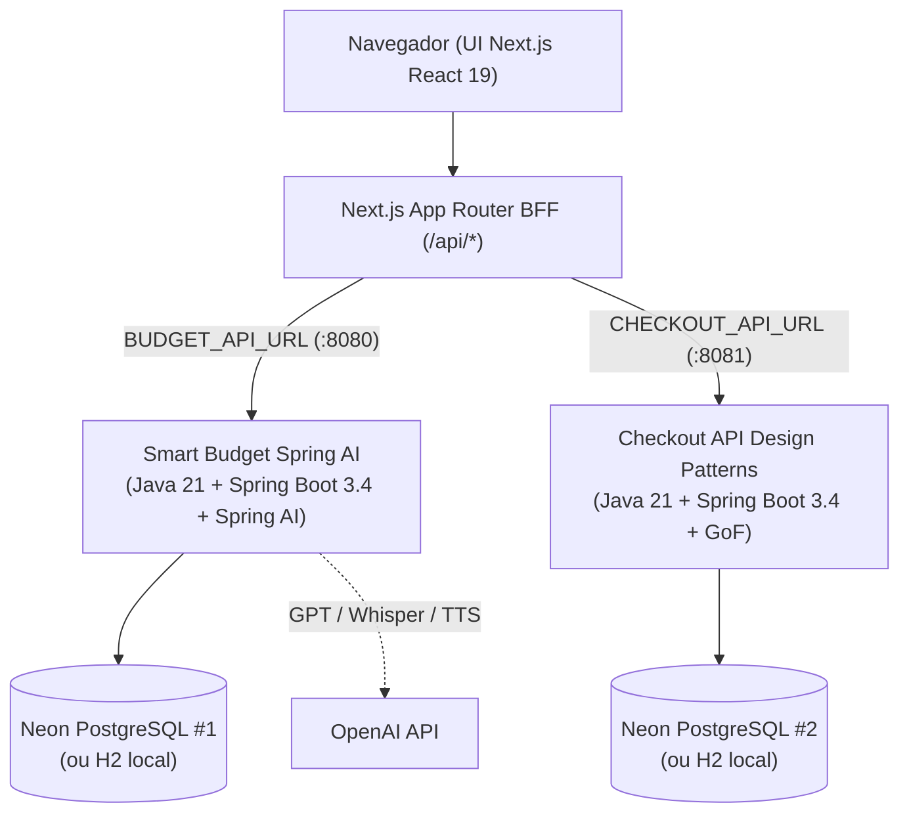

# Portal Unificado — Bootcamp Itaú + DIO (Frontend + BFF)

> **Projeto de Portfólio • Bootcamp Java & IA — Itaú + DIO**  
> Aplicação **Frontend + BFF (Backend for Frontend)** em **Next.js (App Router) + TypeScript + Tailwind CSS** que unifica dois microsserviços **Java 21 / Spring Boot 3.4** independentes em uma experiência coesa de **Super-App Financeiro (Loja GoF + Gestão Financeira com IA)**.

*(Projeto educacional e de portfólio desenvolvido durante o Bootcamp do Itaú em parceria com a DIO. Não é um produto oficial do Itaú Unibanco S.A.)*

---

## Microsserviços Integrados

| Serviço | Repositório | Porta Local Padrão | Responsabilidade |
| :--- | :--- | :---: | :--- |
| **Smart Budget Spring AI** | [GabrielVSL/Smart-Budget-Spring-AI](https://github.com/GabrielVSL/Smart-Budget-Spring-AI) | `8080` | Controle financeiro pessoal, resumo consolidado, alerta de déficit e Consultor IA (Spring AI + Tool Calling + Whisper STT + OpenAI TTS) |
| **Checkout API Design Patterns** | [GabrielVSL/Checkout-Api-Design-Patterns](https://github.com/GabrielVSL/Checkout-Api-Design-Patterns) | `8081` | Checkout de e-commerce aplicando Design Patterns GoF (Facade, Strategy, Chain of Responsibility, Singleton) e SOLID |

---

## Arquitetura do Sistema (BFF + Database per Service)



### Diferenciais da Camada BFF (`src/app/api/**`)
- **Zero CORS no navegador:** todas as chamadas passam por Route Handlers do Next.js (`/api/budget/*`, `/api/checkout/*`, `/api/bff/*`).
- **Normalização de erros EN/PT (`src/lib/bff-proxy.ts`):**
  - `Smart-Budget` retorna `{ timestamp, status, error, message, path, details }`.
  - `Checkout-API` retorna `{ timestamp, status, erro, mensagem, path, detalhes }`.
  - O BFF padroniza ambos para `{ status, title, message, details: string[], service: "budget" | "checkout" }`.
- **Orquestração Cross-Service (`POST /api/bff/checkout-with-budget`):**
  1. Dispara `POST /api/v1/checkout` na Checkout API.
  2. Se retornar `201 Created` e o usuário marcou *"Lançar compra automaticamente no Smart Budget"*, dispara `POST /api/v1/transactions` no Smart Budget com a despesa consolidada.
  3. **Falha parcial controlada:** se o pedido for aprovado mas o Smart Budget estiver offline, o pedido é preservado e o usuário recebe feedback transparente.
- **Resiliência (HTTP `502` e Modo Demo):**
  - Erro `502` no chat de IA (ex.: `OPENAI_API_KEY` ausente) exibe orientação amigável sem afetar o restante do portal.
  - Se os backends estiverem desligados, um banner permite ativar o **Modo Demo Interativo** para testar UI, regras `422` do Lab GoF e lançamentos diretamente no navegador.

---

## Telas e Funcionalidades

1. **Visão Geral (`/`)** — Hero institucional do Bootcamp Itaú + DIO, KPIs em tempo real (Saldo Líquido, Receitas, Despesas, Pedidos), alerta de `deficitAlert` e atividade recente dos dois serviços.
2. **Loja & Checkout (`/shop`)** — Catálogo curado (incluindo `PROD-LIMITADO` com máx. 3 un. e `PROD-SEM-ESTOQUE` para testes reais), barra dinâmica de **Frete PAC Grátis (R$ 500)**, previsão de impacto no saldo do Smart Budget (com alerta se entrar em déficit), **Laboratório de Design Patterns (GoF)** colapsável para disparar cenários `422` reais, e histórico de pedidos com modal de detalhes por ID.
3. **Finanças & Consultor IA (`/budget`)** — Cards de resumo, gráfico SVG responsivo de despesas por categoria, extrato com filtros (`category` e `type`), modal de novo lançamento e **Consultor Financeiro IA** com texto, sugestões clicáveis, gravação de voz (`MediaRecorder` → Whisper STT), toggle de resposta falada (OpenAI TTS com player `audioBase64`) e auto-refresh após *Tool Calling*.
4. **Arquitetura & Bootcamp (`/architecture`)** — Vitrine técnica para recrutadores com topologia visual, decisões arquiteturais, monitor de saúde ao vivo (latência + status) e links diretos para GitHub e Swagger UI.

---

## Como Rodar os 3 Repositórios Juntos Localmente

### Pré-requisitos
- **Java 21** e **Maven** (para os 2 microsserviços backend)
- **Node.js 20+** e **npm** (para este portal Next.js)
- *(Opcional)* Chave `OPENAI_API_KEY` para habilitar GPT, Whisper STT e OpenAI TTS no Smart Budget

### 1. Subir o Smart Budget Spring AI (porta `8080`)

```bash
git clone https://github.com/GabrielVSL/Smart-Budget-Spring-AI.git
cd Smart-Budget-Spring-AI

# Opcional: habilita o Consultor IA (sem ela, as rotas financeiras continuam funcionando normalmente)
export OPENAI_API_KEY=sk-sua-chave-aqui   # PowerShell: $env:OPENAI_API_KEY="sk-sua-chave-aqui"

mvn spring-boot:run
```

> O Smart Budget sobe por padrão em `http://localhost:8080` com banco H2 em memória.

### 2. Subir a Checkout API Design Patterns (porta `8081`)

Em outro terminal:

```bash
git clone https://github.com/GabrielVSL/Checkout-Api-Design-Patterns.git
cd Checkout-Api-Design-Patterns

# Sobe na porta 8081 para não colidir com o Smart Budget (8080)
mvn spring-boot:run -Dspring-boot.run.jvmArguments="-Dserver.port=8081"
```

> Alternativa caso esteja rodando o JAR empacotado:
> ```bash
> mvn clean package -DskipTests
> java -Dserver.port=8081 -jar target/*.jar
> ```

### 3. Subir este Portal Unificado (Frontend + BFF) na porta `3000`

Em um terceiro terminal:

```bash
cp .env.example .env.local
npm install
npm run dev
```

Acesse **[http://localhost:3000](http://localhost:3000)** e verifique no cabeçalho os dois indicadores verdes: **Checkout: Online** e **Smart Budget: Online**.

---

## Variáveis de Ambiente

Veja [`.env.example`](.env.example):

```env
BUDGET_API_URL=http://localhost:8080
CHECKOUT_API_URL=http://localhost:8081
NEXT_PUBLIC_BUDGET_SWAGGER_URL=http://localhost:8080/swagger-ui/index.html
NEXT_PUBLIC_CHECKOUT_SWAGGER_URL=http://localhost:8081/swagger-ui/index.html
```

---

## Arquitetura em Produção com Neon PostgreSQL

Em produção, recomenda-se seguir rigorosamente o padrão **Database per Service**:

1. **Neon PostgreSQL — Banco #1 (`smart-budget-db`):** conectado exclusivamente ao serviço `Smart-Budget-Spring-AI` (ex.: Render, Railway ou Fly.io) via `SPRING_DATASOURCE_URL` (PostgreSQL SSL) + `OPENAI_API_KEY`.
2. **Neon PostgreSQL — Banco #2 (`checkout-api-db`):** conectado exclusivamente ao serviço `Checkout-Api-Design-Patterns`, mantendo o isolamento total de esquema, escalabilidade e falhas.
3. **Vercel (Este Repositório):** configure `BUDGET_API_URL` e `CHECKOUT_API_URL` apontando para as URLs HTTPS públicas de cada backend Java. Como o BFF executa server-side na Vercel, não há exposição de segredos nem necessidade de liberar CORS aberto nos microsserviços.

---

## Rotas do BFF

| Método | Rota BFF | Destino Backend |
| :---: | :--- | :--- |
| `GET` | `/api/health` | Probe de saúde + latência dos 2 microsserviços |
| `POST` | `/api/bff/checkout-with-budget` | Orquestra `POST /api/v1/checkout` + `POST /api/v1/transactions` |
| `GET` / `POST` | `/api/budget/transactions` | `Smart-Budget` → `/api/v1/transactions` |
| `GET` | `/api/budget/transactions/summary` | `Smart-Budget` → `/api/v1/transactions/summary` |
| `POST` | `/api/budget/assistant/chat` | `Smart-Budget` → `/api/v1/assistant/chat` |
| `POST` | `/api/budget/assistant/voice` | `Smart-Budget` → `/api/v1/assistant/voice` |
| `POST` | `/api/checkout` | `Checkout-API` → `/api/v1/checkout` |
| `GET` | `/api/checkout/pedidos` | `Checkout-API` → `/api/v1/checkout/pedidos` |
| `GET` | `/api/checkout/pedidos/[id]` | `Checkout-API` → `/api/v1/checkout/pedidos/{id}` |

---

## Scripts Disponíveis

```bash
npm run dev        # Servidor de desenvolvimento (porta 3000)
npm run build      # Build de produção Next.js
npm run start      # Inicia o build de produção
npm run typecheck  # Validação TypeScript (tsc --noEmit)
npm run lint       # Validação ESLint
```
