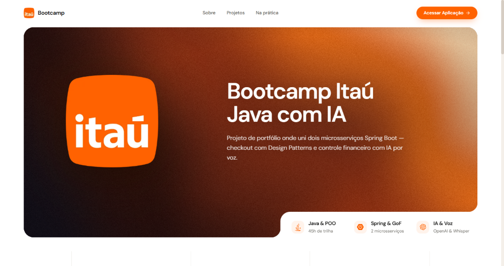
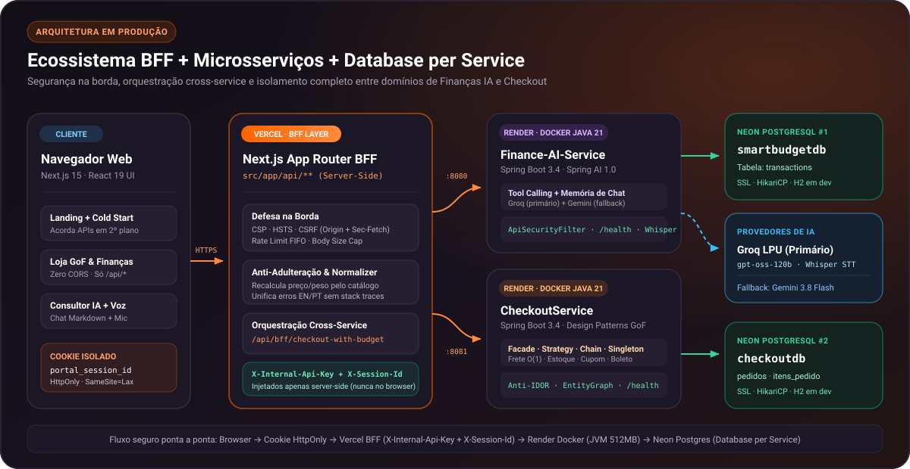

# Portal Unificado — Bootcamp Itaú + DIO (Frontend & BFF)

**Super-App financeiro em Next.js 15 + TypeScript que atua como camada BFF (Backend for Frontend) orquestrando dois microsserviços Java 21 / Spring Boot 3 independentes em produção.**

 

> *Projeto educacional e de portfólio desenvolvido durante o Bootcamp Java & IA (Itaú + DIO). Não possui vínculo comercial nem representa produto oficial do Itaú Unibanco S.A.*

---

## Ecossistema de Repositórios

Este portal conecta e unifica os dois microsserviços construídos ao longo do bootcamp em uma experiência única, mantendo separação estrita de domínios e bancos de dados:

| Repositório | Stack Principal | Responsabilidade |
| :--- | :--- | :--- |
| **[ItauBootcamp](https://github.com/GabrielVSL/ItauBootcamp)** *(este repo)* | Next.js 15 · React 19 · TypeScript · Tailwind 4 | Interface do usuário + camada **BFF** (segurança de borda, sessão isolada, validação de catálogo, orquestração cross-service e gestão de cold start) |
| **[CheckoutService](https://github.com/GabrielVSL/CheckoutService)** | Java 21 · Spring Boot 3.4 · JPA · PostgreSQL/H2 | Microsserviço de pedidos e checkout aplicando Design Patterns GoF (**Facade, Strategy, Chain of Responsibility, Singleton**) e SOLID |
| **[Finance-AI-Service](https://github.com/GabrielVSL/Finance-AI-Service)** | Java 21 · Spring Boot 3.4 · Spring AI 1.0 · Groq/Gemini | Microsserviço de finanças pessoais + **Consultor Financeiro IA** multimodal (chat com memória, voz via Whisper STT e Tool Calling no banco) |

---

## Arquitetura do Sistema

  

### Por que escolhi esta arquitetura?

| Decisão Arquitetural | Motivação e Trade-off |
| :--- | :--- |
| **BFF (Backend for Frontend) com Next.js Route Handlers** | Em vez de expor URLs, segredos e regras dos microsserviços Java diretamente no navegador (o que exigiria CORS aberto e acoplaria o front a dois contratos diferentes), todas as chamadas passam por `/api/*` no servidor da Vercel. Isso permite esconder `INTERNAL_API_KEY`, normalizar contratos de erro em idiomas distintos (EN/PT) e impedir adulteração de preços antes mesmo do payload chegar ao Java. |
| **Orquestração Cross-Service no BFF (`POST /api/bff/checkout-with-budget`)** | Manter `CheckoutService` e `Finance-AI-Service` desacoplados sem que um conheça a URL do outro. Quando o usuário finaliza uma compra com sincronização financeira ativa, o BFF confirma o pedido (`201 Created`) e, em seguida, lança a despesa no gestor financeiro com **tratamento explícito de falha parcial** (se o segundo serviço falhar, o pedido aprovado é preservado e o usuário é avisado com transparência). |
| **Database per Service no Neon PostgreSQL** | Um único projeto gratuito no Neon hospeda dois bancos isolados (`checkoutdb` e `smartbudgetdb`). Cada microsserviço tem esquema, ciclo de vida e pool HikariCP independentes — além de fallback automático para H2 em memória no ambiente local e nos testes. |
| **Isolamento de Visitantes via Cookie `HttpOnly` -> `X-Session-Id`** | Em um portal de portfólio aberto ao público sem fluxo obrigatório de cadastro, compartilhar uma tabela global vazaria nomes, e-mails e lançamentos entre visitantes. O BFF gera um UUID por navegador em cookie `HttpOnly; SameSite=Lax; Secure` e encaminha `X-Session-Id` server-side para ambos os backends, garantindo isolamento total e prevenção contra IDOR. |
| **Renderização de Markdown 100% em React (`SafeMarkdown`)** | As respostas da IA trazem negrito, listas e tabelas de planejamento financeiro. Em vez de usar `dangerouslySetInnerHTML` (vetor clássico de XSS caso o LLM retorne HTML injetado), foi criado um parser enxuto em React JSX puro. |

---

## Desafios Reais Enfrentados e Como Foram Resolvidos

1. **Cold Start em Infraestrutura Gratuita (Render Free 750h/mês)**
   - **Problema:** Manter 2 serviços Java acordados 24/7 com pings externos consome `~1.440h/mês`, ultrapassando o limite de `750h/mês` do plano gratuito do Render (imposto pelos provedores para conter abuso e mineração). Deixá-los hibernar, porém, causava timeouts e falsa impressão de aplicação quebrada na primeira visita.
   - **Solução:** O `AppStatusProvider` dispara um wake-up silencioso (`/api/health?wake=1`) **no instante em que o visitante abre a Landing Page (`/`)**, aproveitando o tempo de leitura inicial para subir os containers. Se o usuário entrar no portal antes do boot concluir, o `ServerWakeupGate` exibe status ao vivo por microsserviço, barra de progresso, explicação transparente da infraestrutura sob demanda e opção de navegar em **Modo Demo** enquanto os servidores terminam de iniciar (liberando a conexão real automaticamente quando prontos).

2. **Adulteração de Preço e Peso pelo Navegador (*Price/Weight Tampering*)**
   - **Problema:** Enviar `precoUnitario` e `pesoTotalKg` calculados no client permitiria alterar valores no DevTools antes do checkout.
   - **Solução:** O BFF (`src/lib/validation.ts`) descarta qualquer preço, nome ou peso enviado pelo navegador e **recalcula tudo no servidor** a partir do catálogo oficial (`src/lib/catalog.ts`) antes de repassar ao `CheckoutService`.

3. **Normalização de Contratos Heterogêneos (EN vs PT)**
   - **Problema:** `Finance-AI-Service` responde erros em inglês (`error`, `message`, `details`) enquanto `CheckoutService` usa português (`erro`, `mensagem`, `detalhes`).
   - **Solução:** `src/lib/bff-proxy.ts` normaliza qualquer erro upstream para um contrato único (`NormalizedApiError`), truncando mensagens longas, bloqueando stack traces em respostas `5xx` e protegendo o navegador contra respostas acima de `5 MB`.

4. **UX do Consultor IA (Memória, Voz e Layout de Dropdowns)**
   - **Problema:** Conversas se perdiam ao navegar entre abas; o dropdown de categoria dentro do modal de novo lançamento era cortado pelo `overflow-y-auto` do container; respostas com `**negrito**` e tabelas ficavam cruas e a leitura em voz alta lia asteriscos.
   - **Solução:** Histórico persistido e sincronizado via `localStorage` + envio das últimas 8 mensagens como contexto para a IA; `CustomSelect` migrado para `createPortal(..., document.body)` com posicionamento dinâmico (`position: fixed` + auto-flip); e `SafeMarkdown` + `stripMarkdownForSpeech` para leitura limpa em voz alta (`pt-BR`).

---

## Camadas de Segurança Implementadas no BFF

- **Headers HTTP defensivos (`next.config.ts`):** `Content-Security-Policy` restritiva, `Strict-Transport-Security` (HSTS), `X-Frame-Options: DENY`, `X-Content-Type-Options: nosniff`, `Referrer-Policy` e `Permissions-Policy` (microfone apenas `self`).
- **Proteção CSRF (`src/lib/security.ts`):** validação de `Origin` vs `Host` + bloqueio de `Sec-Fetch-Site: cross-site` em todas as rotas de mutação (`POST`/`PUT`/`PATCH`/`DELETE`).
- **Rate Limiting em memória com evicção FIFO:** buckets dedicados por IP (`ai-chat: 15/min`, `ai-voice: 8/min`, `write: 30/min`) com teto de memória anti-flood.
- **Autenticação server-to-server (`X-Internal-Api-Key`):** enviada exclusivamente pelo BFF aos microsserviços no Render, impedindo acesso direto de terceiros às APIs de IA e Checkout.
- **Upload de áudio validado na borda:** checagem antecipada de `Content-Length` (`<= 5 MB`), allowlist estrita de MIME types e substituição do nome original por `gravacao.<ext>`.

---

## Rotas do BFF (`src/app/api/**`)

| Método | Rota BFF | Destino e Função |
| :---: | :--- | :--- |
| `GET` | `/api/health` | Sondagem leve (`GET /health`) dos dois microsserviços + suporte a `?wake=1` para ativação sob demanda |
| `POST` | `/api/bff/checkout-with-budget` | Orquestração cross-service: valida catálogo, cria pedido no `CheckoutService` e sincroniza despesa no `Finance-AI-Service` |
| `GET` / `POST` | `/api/budget/transactions` | Listagem filtrada e cadastro manual de receitas/despesas isolados por sessão |
| `GET` | `/api/budget/transactions/summary` | Resumo consolidado (receitas, despesas, saldo líquido e `deficitAlert`) |
| `POST` | `/api/budget/assistant/chat` | Chat com IA (texto + histórico recente para continuidade de planos financeiros) |
| `POST` | `/api/budget/assistant/voice` | Upload multipart de áudio para transcrição Whisper STT + execução no agente IA |
| `POST` | `/api/checkout` | Fechamento direto de pedido com recálculo server-side de preço/peso |
| `GET` | `/api/checkout/pedidos` | Histórico de pedidos da sessão atual |
| `GET` | `/api/checkout/pedidos/[id]` | Consulta detalhada de pedido por ID (escopo restrito à sessão) |

---

## Infraestrutura em Produção

- **Frontend + BFF:** hospedado na **Vercel** (Next.js App Router server-side), sem exposição de segredos ao navegador.
- **Microsserviços Java 21:** containers Docker multi-stage não-root rodando no **Render** com ativação sob demanda já disparada na Landing Page.
- **Banco de Dados:** **Neon PostgreSQL** seguindo *Database per Service* (`smartbudgetdb` e `checkoutdb` isolados via SSL).

